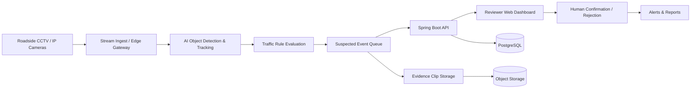

# Intelligent Road Monitoring (IRM)

**Khmer concept name:** គតិចរ  
**Project type:** AI-powered road safety monitoring and traffic analytics platform  
**Target users:** Road safety authorities, municipalities, traffic operations centers, fleet operators, and private property operators  
**Primary market:** Cambodia  
**Languages:** Khmer (default) and English

## 1. Project overview

**Intelligent Road Monitoring (IRM)** uses roadside cameras, computer vision, and AI to analyze road activity, identify *potential* traffic violations and risky driving behavior, and help authorized reviewers make informed decisions. It combines live monitoring, incident review, evidence management, alerts, and analytics in one platform.

**Mission:** Improve road safety by detecting dangerous situations early, documenting potential violations accurately, and providing actionable traffic insights.

> **Important:** AI detections are *suspected events*, not automatically confirmed legal violations. Qualified human reviewers should confirm incidents against applicable Cambodian traffic laws before enforcement. Never use face recognition as a default requirement.

## 2. Goals

- Monitor roads through authorized CCTV, IP camera, and recorded video sources.
- Detect and classify potential unsafe-driving events and traffic-rule violations.
- Notify operators of time-sensitive hazards.
- Store verifiable incident evidence for authorized investigation.
- Measure road safety patterns by place, time, and incident type.
- Provide a Khmer-first interface for local teams.
- Support privacy, auditability, and human review.

## 3. User roles

| Role | Main permissions |
|---|---|
| Super Admin | Manage organization, security policies, system configuration and users |
| Organization Admin | Manage sites, cameras, detection rules and team access |
| Traffic Operator | View live feeds, receive alerts and triage incidents |
| Incident Reviewer | Review video evidence, confirm/reject AI detections and add reasons |
| Supervisor | Approve escalations, monitor team performance and reporting |
| Analyst | Access aggregated analytics and export authorized reports |
| Viewer | View assigned dashboards only |

Use **role-based access control (RBAC)** with site/camera-level scope.

## 4. Core features

### 4.1 Camera and video source management
- Register CCTV/IP cameras, RTSP streams, NVR feeds, and uploaded video.
- Manage camera name, road segment, GPS location, timezone, installation direction and status.
- Live preview, stream health, offline notifications and connection history.
- Define per-camera regions of interest, stop lines, lanes, allowed directions and restricted zones.
- Save camera calibration profiles and versioned configuration changes.
- Support edge AI inference when network bandwidth is limited.

### 4.2 AI vehicle and road-user detection
- Detect cars, motorcycles, buses, trucks, bicycles and pedestrians.
- Track objects **within a camera view** using ephemeral tracking IDs.
- Estimate vehicle counts, class and direction of movement.
- Detect stopped vehicles, congestion and unusual movement.
- Show bounding boxes, confidence levels and camera overlays.
- Provide optional plate text extraction **only where legally permitted, justified, and authorized**, with access restrictions and retention controls.

### 4.3 Potential traffic violation detection

| Detection | Description | Dependencies / limitations | Priority |
|---|---|---|---|
| Red-light running | Vehicle crosses configured stop line while verified signal is red | Requires reliable signal-state integration or validated visual signal recognition | MVP |
| Wrong-way driving | Vehicle moves against configured allowed direction | Requires road-direction and camera-zone calibration | MVP |
| Illegal parking/stopping | Vehicle remains in a restricted zone beyond an allowed time | Requires zone maps, posted-rule configuration and duration thresholds | MVP |
| Solid-line crossing | Vehicle crosses a configured prohibited road marking | Requires clear lane marking and camera angle | Phase 2 |
| No motorcycle helmet | Detect likely unhelmeted riders | Camera resolution, lighting and occlusion affect accuracy | Phase 2 |
| Unsafe lane change | Detect abrupt or prohibited lateral movement | Needs reliable multi-frame tracking and lane geometry | Phase 2 |
| Speeding | Flag speed above a configured limit | Requires calibrated measurement, validation, and legally acceptable evidence; ordinary video alone is insufficient for enforcement-grade speed claims | Phase 3 |
| Phone use while driving | Flag visible hand-held phone use | Often unreliable from distant road cameras; pilot only | Research |
| Seat belt non-use | Flag visible missing seat belts | Requires suitable close-up camera placement; pilot only | Research |

**Detection workflow:** Video stream → frame processing → object detection/tracking → rule evaluation → suspected incident → evidence clip → reviewer decision → notification/report.

### 4.4 Unsafe driving and road hazard detection
- Detect sudden stopping, prolonged obstruction and potential collision events.
- Identify unusual traffic movement patterns for operator attention.
- Detect pedestrian presence in configured high-risk zones.
- Alert for blocked intersections and road obstructions.
- Use a **risk indicator** based on explainable observed events; do not label a particular driver “unsafe” solely from a single model output.

### 4.5 Real-time monitoring dashboard
- Multi-camera live view and selectable single-camera focus.
- Map view showing monitored road locations and camera health.
- Live suspected-incident queue with severity and acknowledgment state.
- Filters by time, location, incident type, camera and review status.
- Operational KPIs: online cameras, traffic volume, pending reviews, confirmed events, and alert response time.
- Khmer/English toggle and responsive desktop/tablet layout.

### 4.6 Incidents and evidence management
- Create an incident with unique ID, type, date/time, location, camera, AI model version and confidence score.
- Attach snapshots and short pre-/post-event video clips with overlays.
- Include bounding boxes, zone/stop-line geometry and relevant contextual signals.
- Track incident statuses: **New → Under Review → Confirmed / Rejected → Escalated → Closed**.
- Require reviewer identity, timestamp and reason for every confirmation/rejection.
- Allow corrections, comments and duplicate-event merging.
- Tamper-evident file hashes, append-only audit logs and chain-of-custody history.
- Download/export evidence only with appropriate permissions and audit records.

### 4.7 Alerts and notifications
- Dashboard notifications for high-priority incidents.
- Configurable email/Telegram notifications for authorized staff.
- Escalation rules by event severity, camera zone and work shift.
- Alert acknowledgment, assignment and resolution tracking.
- Rate limiting and duplicate suppression to reduce alert fatigue.
- Separate **real-time safety alerts** from **review-required violation reports**.

### 4.8 Analytics and reporting
- Traffic volume by hour, day, camera, location and vehicle category.
- Suspected vs. confirmed incident counts and review approval/rejection rates.
- Hotspot maps and time-of-day trends.
- Average time to acknowledge and resolve alerts.
- Compare trends before/after safety interventions.
- Export PDF/CSV reports and scheduled summaries.
- Explain limitations: trends may change with camera uptime, weather, coverage, and model accuracy.

### 4.9 Rules and model administration
- Configure intersection geometry, legal direction, restricted areas and event thresholds per camera.
- Store rule validity dates and local regulatory references.
- Set confidence thresholds by event type without bypassing human review.
- Version AI models and roll back poor-performing versions.
- Maintain labeled validation datasets representing Cambodian traffic conditions.
- Track precision, recall, false-positive rate, latency and drift across day/night/rain conditions.

### 4.10 Security and privacy
- Encrypted camera connections where supported; TLS for application traffic and encrypted storage.
- RBAC, multi-factor authentication for privileged users and least-privilege service access.
- Maintain audit logs for playback, export, review and configuration edits.
- Configurable retention and automated deletion for raw footage and evidence.
- Blur non-relevant faces and plates in general-purpose dashboards and exported analytics.
- Limit identifiable tracking across locations; avoid persistent identity profiles by default.
- Implement access/retention practices based on verified applicable Cambodia law and organizational policy.
- Clearly identify camera locations and establish a lawful operating basis before production deployment.

## 5. Main application pages

1. **Overview:** KPIs, incident trends, active alerts and camera health.
2. **Live Monitoring:** Multi-camera feeds, filters and road overlays.
3. **Map:** Camera locations, traffic hotspots and location drill-down.
4. **Incidents:** Searchable queue, review decisions and assignments.
5. **Incident Detail:** Clip/snapshot, metadata, supporting signals and review timeline.
6. **Reports:** Safety statistics, comparisons and exports.
7. **Cameras:** Source setup, status, geometry and calibration.
8. **AI Rules:** Event rules, thresholds, model versions and validation.
9. **Team & Access:** Users, roles and permission scopes.
10. **Settings & Audit:** Notifications, privacy, retention, integrations and logs.

## 6. Suggested architecture



### Suggested technology stack

| Layer | Recommendation |
|---|---|
| Web dashboard | Next.js, TypeScript, Tailwind CSS |
| Core API / access management | Spring Boot (Java) |
| AI inference service | Python, PyTorch, OpenCV; evaluate a suitable licensed object-detection model |
| Object tracking | ByteTrack or equivalent |
| Streaming | RTSP ingest with FFmpeg / GStreamer; WebRTC or HLS for browser viewing |
| Asynchronous messaging | Redis Streams, RabbitMQ, or Kafka based on volume |
| Primary database | PostgreSQL + PostGIS for geographic queries |
| Video/evidence storage | S3-compatible object storage with retention policies |
| Real-time client updates | WebSocket or Server-Sent Events |
| Deployment | Docker and GPU-enabled edge or cloud hosts; monitor with Prometheus/Grafana |

**Design note:** Keep inference and video-processing workloads separate from the transactional API. For Cambodia deployments, prioritize intermittent-network recovery, Khmer localization, and affordable edge hardware.

## 7. Example incident record

```json
{
  "incident_id": "IRM-2026-000001",
  "camera_id": "CAM-001",
  "event_type": "POTENTIAL_WRONG_WAY_DRIVING",
  "detected_at": "2026-10-15T15:20:00+07:00",
  "location": "Configured road segment",
  "confidence": 0.92,
  "severity": "HIGH",
  "status": "UNDER_REVIEW",
  "vehicle_category": "motorcycle",
  "model_version": "pilot-v1",
  "evidence": {
    "snapshot_object_key": "incidents/IRM-2026-000001/frame.jpg",
    "clip_object_key": "incidents/IRM-2026-000001/clip.mp4"
  },
  "review": {
    "decision": null,
    "reviewer_id": null,
    "reason": null
  }
}
```

*Example values are illustrative, not actual observations.*

## 8. MVP scope (first release)

### In scope
- Admin login and role-based permissions.
- Connect 1–5 authorized fixed-position cameras at a pilot site.
- Detect and count vehicles; track objects within a camera view.
- Configure road direction, stop lines and parking zones.
- Pilot **wrong-way driving**, **restricted stopping**, and **red-light crossing** where signal state is available and validated.
- Save suspected incidents with clips, frames, and timestamps.
- Reviewer confirmation/rejection workflow and audit history.
- Live monitoring dashboard, incident list and basic reports.
- Khmer-first interface with English optional.

### Out of scope for MVP
- Automatic ticketing or penalties.
- City-wide persistent vehicle identity tracking.
- Automatic cross-camera plate-based tracking.
- Enforcement-grade speeding detection without calibration/certification.
- Production use of unreliable phone-use or seat-belt classifiers.

### MVP acceptance criteria
- A pilot operator can connect a camera and identify its online/offline state.
- Camera zones and road directions can be configured and saved.
- Each detection produces a timestamped incident with viewable evidence.
- A reviewer can confirm or reject incidents, with a required recorded reason.
- All access to incident evidence is permission-controlled and audited.
- System evaluation reports per-class precision, recall, false alarms per camera-hour, and event latency under representative local conditions.
- Thresholds for release are agreed upon based on measured pilot performance, not assumed accuracy claims.

## 9. Roadmap

| Phase | Focus | Deliverables |
|---|---|---|
| Phase 1 — Prototype | Camera ingest and vehicle detection | Working live stream, detection overlays, counts |
| Phase 2 — MVP Pilot | Road rules and human review | 3 event types, evidence clips, Khmer dashboard, audit logs |
| Phase 3 — Reliability | Accuracy and operational deployment | Day/night/rain testing, metrics, alert tuning, edge resilience |
| Phase 4 — Expansion | Additional violations and analytics | Helmet detection, lane crossing, hotspots, advanced reports |
| Phase 5 — Integrations | Optional authorized institutional workflows | APIs, agency reporting, calibrated speed measurement where appropriate |

## 10. Key success metrics

- **Detection quality:** Precision, recall and false-positive rate by event type.
- **Operational quality:** Inference latency, stream uptime, missed-frame rate and alert acknowledgment time.
- **Review quality:** Confirmed/rejected ratio, average review duration and disagreements between reviewers.
- **Coverage:** Number of active cameras and monitored road segments.
- **Safety outcomes:** Trends in observed dangerous events and, where reliable external data exists, actual road incidents.

## 11. Future enhancements

- Multi-intersection traffic flow modeling using aggregated, privacy-preserving data.
- Road-safety heatmaps and near-miss analysis with validated methodology.
- AI-assisted incident summaries in Khmer.
- Dedicated mobile app for field operators.
- Smart-city dashboard integrations and public aggregated traffic statistics.
- Automated camera tamper and obstruction detection.

---

**Product name:** Intelligent Road Monitoring (IRM)  
**Suggested tagline:** **ភ្នែកឆ្លាតវៃ ដើម្បីសុវត្ថិភាពចរាចរណ៍** — *Intelligent Vision for Safer Roads*
